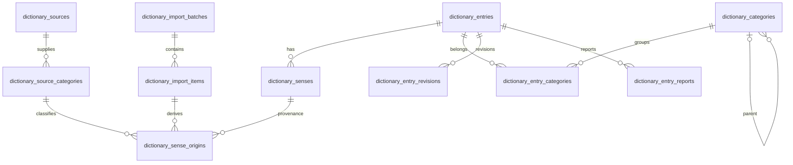

# ADR đề xuất — Dictionary foundation

Status: PROPOSED. Chưa sửa Prisma hoặc tạo migration.

## Quyết định

Module dictionary trong modular monolith, interface → application → domain ports → Prisma adapters. Dùng PostgreSQL sau approval, không Redis/Elasticsearch/cache/microservice. Headword = canonical Chinese+original Pinyin; senses giữ từng cặp nghĩa Việt/Anh khác nhau. Search-fold không là identity. Không dùng learning_items làm kho từ vì thiếu source/rights/multiple senses/lifecycle.

## 12 bảng additive đề xuất cho DICT02–04

| Bảng                         | Cột/constraint cốt lõi                                                                                                              |
| ---------------------------- | ----------------------------------------------------------------------------------------------------------------------------------- |
| dictionary_sources           | publicUUID, label, canonicalURL, rights UNKNOWN/CONFIRMED/DENIED, rights evidence, revision/timestamps                              |
| dictionary_source_categories | sourceFK RESTRICT, original label/index, unique source+label; giữ nguyên nguồn khi taxonomy đổi                                     |
| dictionary_import_batches    | publicUUID, filename basename, SHA256, parserVersion/normalizerVersion, status/summary; unique checksum+versions                    |
| dictionary_entries           | publicUUID, Chinese/Pinyin TEXT, canonical identity hash UNIQUE, search keys, content type, verification/publication, revision/time |
| dictionary_senses            | publicUUID, entryFK RESTRICT, nghĩa Việt/Anh nullable khi thiếu, full linguistic hash UNIQUE, search nghĩa                          |
| dictionary_import_items      | batchFK+ordinal UNIQUE, raw bounded per-row JSON, validation/flags/outcome/senseFK; không serialize cả dictionary                   |
| dictionary_sense_origins     | sense/sourceCategory/importItem FKs, composite unique; giữ mọi row/source association                                               |
| dictionary_categories        | publicUUID, parentFK RESTRICT, slugUNIQUE, vi/zh labels, position/active/revision; depth≤8, no cycles                               |
| dictionary_entry_categories  | entry/category FKs RESTRICT, unique pair, many-to-many                                                                              |
| dictionary_entry_revisions   | entryFK, revision UNIQUE per entry, immutable bounded snapshot/reason/actor/time                                                    |
| dictionary_entry_reports     | entry/revision/reporterFK, bounded comment/status; reporter từ session                                                              |
| dictionary_audit_events      | append-only admin actor/action/target/time/bounded metadata; không learning_events                                                  |

External IDs dùng public UUID, không internal surrogate FK. Archive thay delete published/provenance records. Account-delete retention cần quyết định trước delete support; không cascade mất audit. Source rights và publication status độc lập editorial. Learner reader xét mọi provenance liên quan, không lấy một nguồn CONFIRMED để bỏ qua UNKNOWN. Independent rights grant cần explicit evidence/audit, không tự suy từ import.

Bounds proposal: Chinese≤2000/Pinyin≤4000/meanings≤8000 code points; raw row≤64KiB, file≤16MiB/100000rows. Invalid không truncate: quarantine và báo lý do. Chốt API/schema bounds cùng implementation.

## Import/recovery contract

1. ADMIN+CSRF, explicit import intent; CLI private operator guard dùng cùng service. Không public filesystem paths/URL fetching/SSRF.
2. Adapter versioned HTML inert script#data JSON, JSON/CSV. UTF8 strict/schema/file/row bounds; không eval/vm/iframe/scripts.
3. Raw text, input checksum/filename, ordinal và source/category giữ nguyên. Canonical proposed v1 chỉ NFC/strip U+200B/U+FEFF/trim/collapse whitespace, flag mọi thay đổi. Không fold accents/ü/u/v vào identity.
4. Dry-run đọc/validate/query existing nhưng ZERO DB writes, kể cả batch. File-only audit không bịa số DB inserted/matched.
5. Stage≤500rows/transaction ngắn; STAGED không visible reader. Raw invalid rows giữ outcome. Không full dataset trong API response.
6. Atomic final apply: import namespace transaction lock, serializable/bounded retry; bulk writes canonical entries/senses/origins/revisions, mark COMPLETED cùng commit. Không per-row network queries.
7. Reviewed wording không overwrite khi import: match identity chỉ link provenance; khác meaning giữ sense khác/review queue.
8. Fail apply rollback canonical writes; staging còn, FAILED marker transaction riêng. Retry cùng checksum+versions resume/return COMPLETED receipt, không duplicates. Crash sau commit không tạo batch thứ hai.

Dataset-size transaction timeout/RAM phải đo trên disposable trước chốt chunk/timeout. Các version normalizer mới cần review; không tự reinterpret reviewed identities.

## Search/indexes

B-tree exact Chinese/Pinyin/canonical hash/FKs. Versioned search columns: tone-fold Pinyin spaced/compact, Vietnamese NFD accent-fold đ→d, English lowercase. Ü/v primary khác u; optional alternate-u retrieval hạng thấp và test ambiguity. Không thay display/storage/evaluation.

Đề xuất pg_trgm GIN cho contains sau EXPLAIN ANALYZE disposable. Extension/privileges là approval item migration; không fallback unindexed full-scan âm thầm. Query1–2chars đi bounded exact/prefix path, không wildcard scan vô hạn. SQL parameterized; literal wildcard escaping, allowlisted sort.

Cursor rank+sortkey+publicUUID, bind query/filter/visibility/catalog revision. Catalog đổi thì409 refresh; không hứa pagination stable qua edit. Count/page dùng cùng read snapshot và DISTINCT entry. Đo riêng count overhead để tránh query nặng mỗi phím.

## Sau foundation

DICT05 thêm user_vocabulary/private collections/items/append review history; DICT06 teacher sets/items và sense-revision→LearningItem provenance. DICT07 reuse revisions/audit/import. Không tự tạo tất cả future tables trước task contract/approval.
